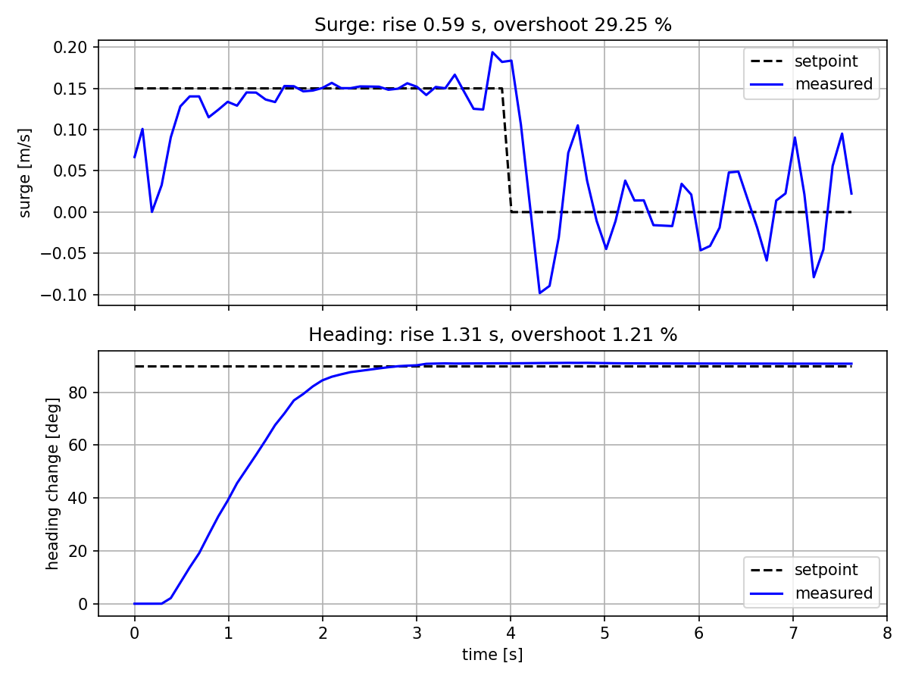
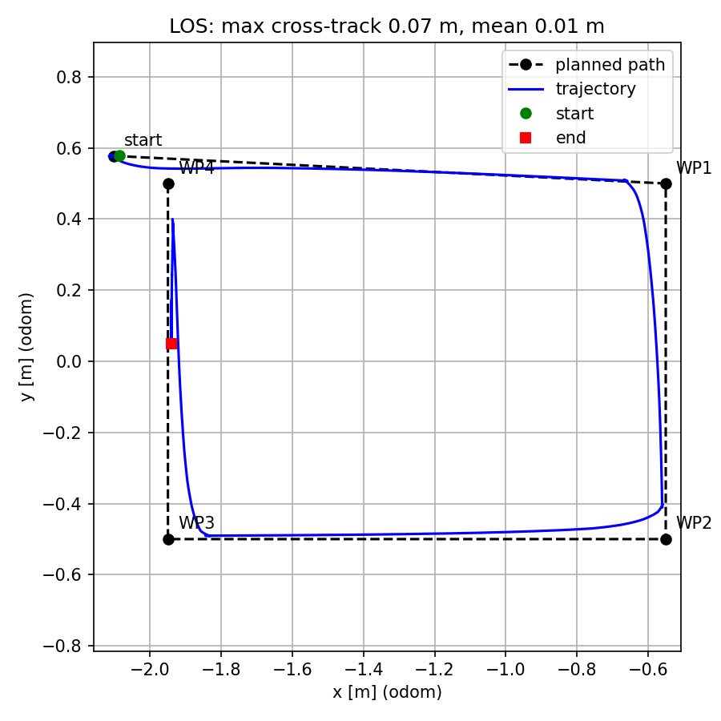

# tsb_control

*Técnico Solar Boat, Autonomous Systems Recruitment - Control phase*

ROS 2 Humble package (ament_python) that controls the surge velocity and the heading of a differential-drive robot. I tested it with the TurtleBot3 Burger in Gazebo Classic. It has a sensor node, a PID node for surge and heading, an allocation node and a Line-of-Sight (LOS) path follower.

## How it works

The data goes through four nodes, one after the other.

`sensor_processing_node` reads `/odom` and `/imu` and publishes `/state` and `/position`. `/state` is a `geometry_msgs/Vector3` with the surge velocity in x (m/s) and the heading in y (rad). `/position` is a `geometry_msgs/Point` with x and y in the odom frame. It publishes at 20 Hz. The heading comes from the IMU yaw, and until the IMU publishes it falls back to the odometry orientation.

`path_follower_node` is optional. It reads `/waypoints` (`nav_msgs/Path`), `/position` and `/state` and publishes `/target_setpoint` (`geometry_msgs/Vector3`, desired surge in x, desired heading in y). Without it you can publish `/target_setpoint` by hand, which is how the step test works.

`pid_node` compares `/target_setpoint` with `/state` using two separate PIDs and publishes `/tau_u` (surge) and `/tau_r` (yaw) as `std_msgs/Float64`. It does not publish anything until it has received both a state and a setpoint, so the robot doesn't move on its own when it starts.

`allocation_node` turns `/tau_u` and `/tau_r` into left and right wheel commands (`/current_left`, `/current_right`, `std_msgs/Float64`) and into a `/cmd_vel` (`geometry_msgs/Twist`) for the TurtleBot3. The wheel speeds are `v_left = tau_u - (L/2) * tau_r` and `v_right = tau_u + (L/2) * tau_r`. If one of them goes above `max_wheel_speed` both are scaled down. `/current_*` are those speeds scaled so that `max_wheel_speed` becomes `max_current`. If no `/tau_*` message arrives for `cmd_timeout` seconds, it publishes zeros.

## Build and run

The repository root is a colcon workspace, so build from there. Use three terminals:

```
cd <repo>
source /opt/ros/humble/setup.bash
colcon build --symlink-install
source install/setup.bash

# terminal 1: simulator
export TURTLEBOT3_MODEL=burger
ros2 launch turtlebot3_gazebo turtlebot3_world.launch.py

# terminal 2: control (source install/setup.bash first)
ros2 launch tsb_control control.launch.py

# terminal 3: 0.15 m/s and heading 1.57 rad (90 deg)
ros2 topic pub --once /target_setpoint geometry_msgs/msg/Vector3 "{x: 0.15, y: 1.57, z: 0.0}"

# or follow a path with LOS (rectangle of 1.4 m x 1.0 m)
ros2 topic pub --once /waypoints nav_msgs/msg/Path "{header: {frame_id: odom}, poses: [
  {pose: {position: {x: -0.55, y: 0.5}}},
  {pose: {position: {x: -0.55, y: -0.5}}},
  {pose: {position: {x: -1.95, y: -0.5}}},
  {pose: {position: {x: -1.95, y: 0.5}}}]}"

# an empty path cancels the current one
ros2 topic pub --once /waypoints nav_msgs/msg/Path "{header: {frame_id: odom}, poses: []}"
```

Waypoints are in the odom frame and no transform is applied. In the TurtleBot3 Gazebo simulation the odometry is given in the world frame (the robot does not start at 0, 0), so the numbers above are world coordinates in the free area of turtlebot3_world. With `start_from_current: true` the robot first drives in a straight line from where it is to the first waypoint. There is no obstacle avoidance, so check that this line is free. On a real robot whose odometry starts at the origin, the waypoints are relative to the start pose.

The gains and other parameters are in `tsb_control/config/pid_params.yaml`. `use_sim_time` is true there because of Gazebo, set it to false on a real robot. You can also change parameters while running with `ros2 param set`.

## PID

The control law is `tau = kff*r + kp*e + ki*integral(e) - kd*dy/dt` with `e = r - y`. For the heading, the error is wrapped to [-pi, pi]. `dt` is measured with the node clock, so it follows the simulation time.

- Feedforward on the surge reference, so the integral only has to fix model errors and a bounded integral is enough to reach the setpoint.
- The derivative is taken on the measurement, so a step in the setpoint does not cause a spike.
- Anti-windup: the integral is limited by `integral_limit` and it also stops integrating while the output is saturated and the error would push it further. `surge.max_tau` is equal to `max_wheel_speed`, so the PID knows the real limit of the actuator.

## LOS guidance

On the active segment A to B, with path angle `alpha`, `e` is the cross-track error (positive to the left of the path). The desired heading is `psi_d = alpha + atan2(-e, lookahead)`. The desired surge is `v_d = cruise_speed * max(0, cos(psi_d - psi))`, so the robot turns first and then moves, and on the last segment it is also limited to `slow_gain * distance_to_goal`.

The next segment starts when the robot is closer than `acceptance_radius` to B, or when it has gone past `L - acceptance_radius` along the segment. At the last waypoint (inside `acceptance_radius`) it publishes `v = 0` and keeps the heading of the last segment. On the last segment, if the goal is closer than the lookahead, it steers straight to the goal, so it still converges after an overshoot. With `start_from_current: true` the path starts at the current position.

## Parameters

Defaults from `pid_params.yaml`:

- pid_node, surge: kp 1.2, ki 0.1, kd 0.05, kff 1.0, integral_limit 1.0, max_tau 0.22
- pid_node, heading: kp 1.8, ki 0.05, kd 0.15, kff 0.0, integral_limit 1.0, max_tau 1.5
- allocation_node: wheel_separation 0.16, max_wheel_speed 0.22, max_current 10.0, cmd_timeout 0.5
- path_follower_node: lookahead 0.5, acceptance_radius 0.15, cruise_speed 0.15, max_speed 0.22, slow_gain 1.0, start_from_current true, rate_hz 20

The gains were not tuned.

## Results

These plots were recorded in Gazebo with the TurtleBot3 Burger, using `scripts/record_plots.py`.



Surge step from 0 to 0.15 m/s for 4 s and a heading step of 90 degrees, then stop.



Rectangle followed with LOS. Dashed is the planned path (from the start pose through the waypoints) and blue is the trajectory. The last position (red square) is about 0.45 m before the last waypoint, see the limitations below.

To get them again, start the simulator with `turtlebot3_world.launch.py` with a freshly spawned robot, start `control.launch.py`, check with `ros2 node list` that every node appears only once, and run `python3 scripts/record_plots.py --experiment both --out docs` (needs python3-matplotlib). Options are `--step-duration`, `--turn-deg`, `--speed` and `--waypoints "x,y;x,y;..."`. The plots are not identical between runs because of timing and noise. With `--experiment both` the step moves the robot forward first, so the LOS path starts from that position.

## Tests

`los.py` does not depend on ROS. The PID and the guidance have unit tests (step response, saturation, anti-windup, angle wrapping, waypoint switching, a square path). The code follows the ament linters (flake8, pep257, copyright, lines up to 79 characters). Run them with `colcon test --packages-select tsb_control --event-handlers console_direct+` and then `colcon test-result --verbose`.

## Limitations

- No obstacle avoidance, and the path is made of straight segments (no smoothing of the corners).
- The surge oscillates after stopping. When the setpoint goes to zero the measured surge swings between about -0.1 and +0.1 m/s for a few seconds (you can see it in the step plot). The surge gains were not tuned. My guess is a delay in the simulated loop (the 10 Hz /clock, the control sampling, the odometry) together with kp = 1.2 and the derivative term, but I did not check this.
- The LOS plot does not end at the last waypoint. The last position is at y of about 0.05 m and the waypoint is at y = 0.5 m, about 0.45 m away. The trajectory does get to y of about 0.4 m, which is inside the 0.15 m acceptance radius, so the follower sees the goal as reached and commands zero speed, and then the robot drifts back. I think it is the same surge oscillation, but I did not isolate it, so take it as a hypothesis and not as a result. The cross-track error in the plot title (0.07 m max) is the distance to the path, so it stays small even if the robot is short of the goal along the path. It does not tell whether the goal was reached.
- The surge overshoot in the title of the step plot (about 29 %) is not reliable. The step lasts only 4 s and the number comes from one spike of 0.19 m/s just before the stop.
- On Ctrl+C the nodes try to publish zero commands but this is not guaranteed. If the PID stops publishing, `allocation_node` stops the robot after `cmd_timeout`.
- The position comes only from the odometry (no GPS, no estimator).
- The setpoint and the state use `geometry_msgs/Vector3`. A custom message with named fields would be clearer.
- It is written in Python, not C++.

## License

Apache-2.0, see `LICENSE`.
